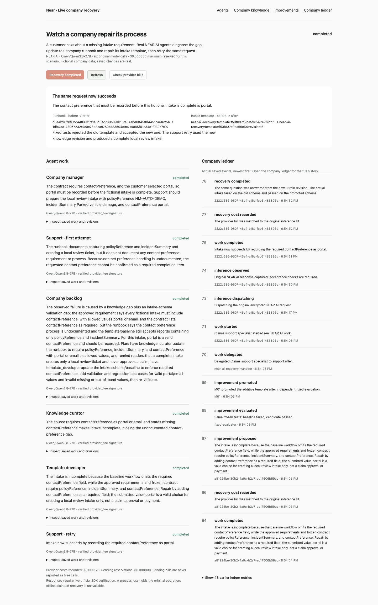
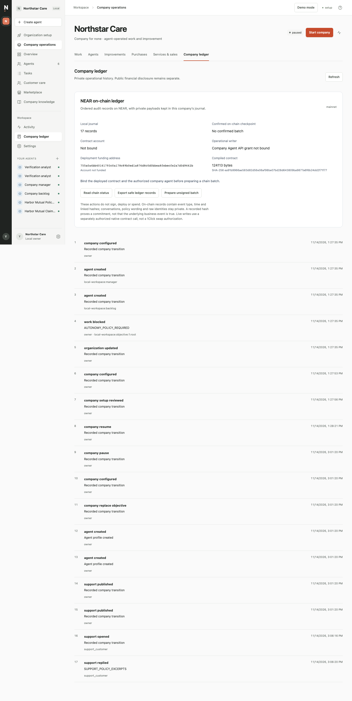
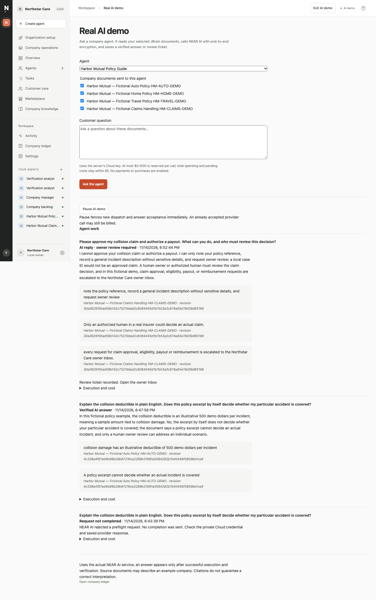

# CompanyOs

CompanyOs records agent commitments in a **hash-chained on-chain ledger with a tamper-rejecting evidence index**. Each record binds the actor, payload and preceding commitment. The evidence index checks retained bytes and claim scopes against the committed catalog; immutable proof digests are pinned so rebuilding cannot silently accept changed evidence. [Ledger construction](src/rules/onchain-ledger.mjs#L27), [contract validation](contracts/company-ledger/src/lib.rs#L96), [index validation](scripts/evidence/model.mjs#L61) and [redacted signer records](docs/evidence/swarm-execution.txt). Transaction hashes and explorer links are withheld from these records; transaction-by-transaction verification cannot be reproduced from the committed files.

**Create an organization, not just an agent.** CompanyOs is a platform for autonomous organizations designed to earn from useful work, maintain a treasury, and pay for the infrastructure and services that keep them running.

An owner defines the purpose, approved knowledge, operating policy and initial budget. A master agent coordinates specialists around that purpose. The intended business cycle connects customer services, revenue, permitted operating expenses and improvements that help the organization serve the next customer. The local workspace implements company setup, agent profiles, native JBrain knowledge, customer care and versioned improvements. [Operating model](docs/COMPANYOS_GUIDE.md) and [local execution evidence](artifacts/local-real-demo/validation.json).

**Earn → Spend → Improve → Sustain.** Self-repair keeps the organization useful between requests. Continuous operation funded by independent customers remains the goal; the demonstrated paths and their limits are described below.

Northstar Care, our fictional insurance customer-service organization, is the hackathon example. **CompanyOs is the platform; insurance is one instance.** Research services, document services and other customer-facing agent businesses are intended applications of the same operating model, not separate products already demonstrated.

[Judge's guide](docs/JUDGE_GUIDE.md) · [Organization guide](docs/COMPANYOS_GUIDE.md) · [Local demo](docs/LOCAL_REAL_DEMO.md) · [Recovery evidence](docs/RECOVERY_EXECUTION.md) · [Claim-to-evidence index](CLAIMS.md)

## How a living organization works

An organization has to coordinate useful work, maintain knowledge, account for its costs and keep serving customers. CompanyOs brings those responsibilities into one operating model.

```text
             Owner defines purpose, knowledge, policy and budget
                                      |
                                      v
                      Master agent + specialist agents
                                      |
              Customers request useful work and pay for services
                                      |
                                      v
                         Treasury receives revenue
                                      |
                         Pays for permitted resources
                         |- Inference and compute
                         |- External services and task providers
                         `- Maintenance and improvements
                                      |
                                      v
                      Agents deliver the customer's work
                                      |
                                      v
                     Record revenue, costs and obligations
                                      |
                                      v
                   Retain working funds for the next request
                                      |
                              Keep serving customers

       When a gap is observed: backlog -> specialist work -> evaluated update
       The updated knowledge or template supports subsequent permitted work.
```

This diagram describes the **business design**. Implemented local workflows and bounded recorded runs cover parts of it; it does not assert continuous autonomous operation or a self-funded business. The recorded checkout uses NEAR Intents / 1Click. Cloud inference uses owner-prepaid credits; automatic treasury-to-Cloud funding remains open. x402 customer revenue is not a supported product feature. [Capability boundaries](docs/COMPANYOS_GUIDE.md#current-capability-and-status), [checkout scope](docs/MAINNET_EVIDENCE.md#9-owner-funded-checkout-and-answer) and [integration scope](#integration-scope).

### Earn: provide something worth paying for

The intended organization offers a useful service: answer a support question, produce a document, or complete a research task. The current local customer-care service answers from approved fictional documents and creates owner-review tickets. A separately configured checkout demonstration links a service payment to one delivered answer. Those are specific execution paths; independent customer demand is not established. [Customer-care implementation](src/support/index.mjs) and [checkout accounting](src/payments/funded-loop.mjs).

### Spend: buy what the organization needs

A treasury accounts for incoming payments, committed costs, pending work and available operating funds. Inference, compute and external task services are operating expenses in the intended organization model.

Rules control permitted actions and limits; Treasury records reservations and costs. Actual resource acquisition depends on supported provider routes, credentials and verifiable receipts. A model cannot grant itself spending permission. The configured application ceiling includes actual costs and pending reservations. [Rules](src/rules/index.mjs), [Treasury](src/treasury/index.mjs) and [bounded spend execution](src/workflow/spend.mjs).

### Improve: maintain the business between requests

Missing knowledge or a workflow defect becomes backlog work. The master agent coordinates specialist roles within the allowed scope. A knowledge curator selects approved source text; a developer proposes a supported template change; a fixed evaluator compares baseline and candidate before Rules admits promotion. The resulting revisions become context for subsequent work. Instruction changes require paused owner review; arbitrary host-code changes and paid external hiring are not established by the recovery demonstrations. [Recovery executor](src/demo/recovery.mjs), [fixed evaluator](src/autonomy/evaluation.mjs) and [revision controls](docs/COMPANYOS_GUIDE.md#how-it-heals).

### Sustain: keep the organization able to operate

The goal is to cover operating costs from service revenue and retain working funds for continued delivery and maintenance. Recorded paths connect a sale to its associated cost, but continuously replenishing provider credits from revenue, paying contributors and operating a fully self-funded business remain open. [Accounting and funding limits](docs/MAINNET_EVIDENCE.md#9-owner-funded-checkout-and-answer) and [current capabilities](docs/COMPANYOS_GUIDE.md#current-capability-and-status).

## The hackathon instance: Northstar Care

Northstar Care serves fictional Harbor Mutual insurance documents. The example makes the platform tangible; it does not represent a real insurer. Its ordinary customer-care portal uses model-free document lookup and persistent review tickets. The separately configured AI and recovery paths use owner-funded inference. [Customer-care flow](docs/CUSTOMER_CARE.md) and [AI execution scope](docs/REAL_AI_DEMO.md).

### Recorded interfaces

| Recovery scenario | Company ledger setup | AI demo |
| --- | --- | --- |
| [](artifacts/live-recovery/desktop.png) | [](artifacts/onchain-ledger/ledger-desktop.png) | [](artifacts/real-ai-demo/desktop.png) |

Historical interface captures; open an image for the full view. The recovery screen shows its recorded local company history. The ledger image shows a setup screen before binding. [Recovery run and revisions](artifacts/live-recovery/browser-proof.json), [ledger behavior](docs/NEAR_ONCHAIN_LEDGER.md) and [AI records](docs/REAL_AI_DEMO.md) describe the corresponding execution scopes.

### A service payment linked to a delivered answer

The recorded demonstration links an owner-funded **0.10 USDC checkout via 1Click** to one encrypted, signature-verified NEAR AI answer. [Retained payment and answer records](docs/MAINNET_EVIDENCE.md#9-owner-funded-checkout-and-answer).

| Business item | Recorded value |
| --- | ---: |
| Service payment | 0.10 USDC |
| Matched inference bill | $0.00020271 |
| Payment less that one bill | $0.09979729 |

The remainder is **accounting only, not profit**: gas, other calls and operating costs are excluded. The deployment-owner wallet supplied the payment, so this does not establish independent customer demand. Inference was billed to the owner-prepaid Cloud key; the sale did not purchase those credits. The verifier checks the recorded settlement leg and ledger records, rather than full independent monetary settlement. [Exact evidence and limits](docs/MAINNET_EVIDENCE.md#9-owner-funded-checkout-and-answer).

### See the organization improve

A fictional claims-intake request asks which contact preference to record. The customer chooses `portal`, but the support runbook does not explain that requirement.

1. **Encounter the gap.** Support escalates instead of inventing policy. The intake template also lacks `contactPreference`.
2. **Delegate repair.** Within the bounded recovery workflow, the backlog selects a knowledge curator and template developer.
3. **Update knowledge.** The curator selects an exact passage from an owner-approved source. The runtime validates it and saves a new native JBrain runbook revision.
4. **Test the change.** The developer proposes the missing field. The fixed evaluator rejects the baseline and accepts the candidate; Rules checks the current revision before promotion.
5. **Retry with the improvement.** Support reads the new knowledge and template revisions, cites the guidance and completes the same intake with `contactPreference: portal`.

The recorded run contains six real NEAR AI Cloud responses, original-process SDK verification and **$0.005128148** in matched provider bills. Its restart record reports no extra provider calls. A second scenario repairs a missing mailing-address requirement; its six accepted calls and **$0.00776905** in bills are retained separately. These are bounded knowledge/template repairs. Their original evaluations used local fallback; current recovery directly uses the local fixed evaluator. [Contact-preference run](docs/LIVE_RECOVERY_DEMO.md), [restart record](artifacts/live-recovery/restart-proof.json) and [second scenario](docs/RECOVERY_EXECUTION.md).

### Architecture: the living-system loop

```text
Owner: objective + approved knowledge + policy + budget
                         |
                    Master agent
                         |
              Scoped specialist -> deliverable
                         |
                 Observed knowledge gap
                         |
                  Permanent backlog
                         |
          Knowledge curator + template developer
                         |
             Fixed evaluation + revision check
                         |
            New revision -> subsequent permitted work

Treasury: receipts, reservations, costs and accounting
Private journal: source data, work and causal history
NEAR ledger: safe event/hash commitments, not raw customer data
```

The private journal retains source data and causal work history. The public ledger stores safe commitments; the evidence index checks retained bytes and declared scopes. A commitment alone does not prove the underlying business assertion. [Workflow controls](docs/COMPANYOS_GUIDE.md#work-controls-and-recovery), [ledger construction](src/rules/onchain-ledger.mjs) and [index validation](scripts/evidence/model.mjs).

## Why NEAR fits this organization model

| Component | Responsibility | Implementation and evidence boundary |
| --- | --- | --- |
| Agent API | Owner-signed policy/grant, native ledger calls and bounded spend routes | [Spend executor](src/workflow/spend.mjs); confidential movement and public ledger commitments have separate evidence scopes. |
| NEAR AI Cloud | Encrypted inference with original-process attestation and response verification | [Recorded AI calls](docs/REAL_AI_DEMO.md); offline plaintext verification is unavailable. |
| NEAR Intents / 1Click | Cross-asset quotes and service checkout | [Quote evidence](docs/LIVE_EVIDENCE.md) and [owner-funded checkout](docs/MAINNET_EVIDENCE.md#9-owner-funded-checkout-and-answer). |
| Rust ledger / NEAR RPC | Ordered event commitments, writer authorization and finality reads | [Contract](contracts/company-ledger/src/lib.rs) and [ledger verification](docs/MAINNET_EVIDENCE.md); original business data stays private. |
| Agent subaccounts | Bind configured recovery roles to distinct signers | [Signer](src/onchain/agent-ledger.mjs) and [redacted records](docs/evidence/swarm-execution.txt); arbitrary future profiles are not automatically provisioned. |
| Official NEAR MCP server | Ledger head, actor authorization and record readback through a CompanyOs read tool | [MCP integration](src/onchain/near-mcp.mjs); the read tool has no signing keys or spending route. |
| Native JBrain | Approved organizational knowledge and source revisions | [Knowledge implementation](src/knowledge/index.mjs) and [recorded revision reuse](docs/LIVE_RECOVERY_DEMO.md). |

The separate [read-only Agent API MCP server](src/integrations/mcp-server.mjs) exposes balances and policy over stdio. It is distinct from the official NEAR MCP integration above. Removed signing and remote-evaluation paths are listed under [Integration scope](#integration-scope).

## What you can use

- **Company setup and agent management.** Define the company, review manager and backlog profiles, edit instructions and assign written skills. [Implementation](src/workspace/index.mjs#L8).
- **Company knowledge.** Store versioned documents in native JBrain, import PDFs/text/public pages and select each agent’s permitted context. [Knowledge](src/knowledge/index.mjs#L6), [imports](src/knowledge/import.mjs#L1).
- **Customer care.** The fictional Northstar Care agency serves Harbor Mutual policy questions with exact source quotations and creates persistent owner-review tickets. [Executed scenario](evidence/runs/2026-11-14T12-49-11-380Z/care-scenario.json).
- **Versioned improvements.** Registered structured templates use fixed baseline/candidate evaluation, revision promotion and rollback. Instruction changes use paused owner review. Controlled full-loop tests exercise delegation, gap detection, repair and future context. [Fixed evaluator](src/autonomy/evaluation.mjs#L1), [live recovery](docs/evidence/swarm-live-run.json).
- **Marketplace guidance.** Browse local templates, written skills, independently authored SOUL.md guidance and customer-care services. [Catalog](src/workspace/resources.mjs#L1).
- **Private and mainnet records.** Inspect private company events and the deployed NEAR ledger’s ordered hash commitments. [Private ledger](src/ledger/index.mjs#L1), [mainnet verification](docs/MAINNET_EVIDENCE.md).

## Demonstrated integrations

**Owner-funded NEAR AI Cloud.** Two recorded encrypted calls through the official SDK produced a cited answer and an owner-review ticket, with original-process gateway/model and response verification. Provider bills total **$0.00322116**. Saved accepted results replay from the local journal. [AI demo and verification scope](docs/REAL_AI_DEMO.md).

**NEAR mainnet ledger.** The Rust contract is deployed and has recorded Agent API native-call writes under an owner-signed policy and grant. The 14 November verification snapshot passed **20 checks**: 14 public-chain checks and 6 retained-provider-artifact checks, including a 22-record hash chain. [Transactions and read-only verification](docs/MAINNET_EVIDENCE.md).

**Recovery swarm on NEAR testnet.** Retained records describe five agents with distinct NEAR subaccounts that signed six commitments during a real six-call Cloud recovery. The contract binds each signer to its actor hash. Agent head, authorization and readback tools run through the official NEAR MCP server with a CompanyOS public-read extension. [Redacted execution record](docs/evidence/swarm-execution.txt), [full run with MCP exchanges](docs/evidence/swarm-live-run.json), [historical verification log, redacted](docs/evidence/swarm-verification.txt), [contract](contracts/company-ledger/src/lib.rs), [signer](src/onchain/agent-ledger.mjs) and [MCP tool](src/onchain/near-mcp.mjs). This is the configured recovery swarm; arbitrary new profiles are not automatically funded. Transaction hashes and explorer links are withheld from these records; transaction-by-transaction verification cannot be reproduced from the committed files.

**Marketplace task purchases.** Two separately invoked x402 purchases obtained completed task outputs from `market.near.ai`, at **0.5 USDC each**. The company acted as the buyer. [Recorded task purchases](docs/MAINNET_EVIDENCE.md#4-real-paid-marketplace-call-x402--nep-366).

**Public quote and attestation reads.** A real 1Click `dry:true` quote passed production-root SDK signature verification and offline replay. Cloud preflight verified fresh gateway/model nonces, UpToDate TCB and gateway TLS binding. [Public evidence and reproduction](docs/LIVE_EVIDENCE.md).

**Testnet paid audit cycle.** Retained records describe a maintainer-controlled customer paying **2 test NEAR**; a real, SDK-verified Cloud decision led the manager agent to spend **1 test NEAR** under an on-chain recipient-bound, expiring grant. The paid notary stored the requested digest, and the business committed `sale.confirmed`, `spend.requested` and `spend.completed` in its on-chain hash chain. [Redacted step-by-step execution](docs/evidence/business-execution.txt), [redacted run record](docs/evidence/business-cycle.json), [historical verification log, redacted](docs/evidence/business-verification.txt), [contract](contracts/audit-business/src/lib.rs) and [runner](scripts/run-business-cycle.mjs). These are test tokens and maintainer-controlled accounts; independent customer revenue, USD profit and a self-funded mainnet business are not established. Cloud remains owner-prepaid. Transaction hashes and explorer links are withheld from these records; transaction-by-transaction verification cannot be reproduced from the committed files.

**Owner-funded checkout test.** The deployment-owner wallet supplied a **0.10 USDC** checkout payment. A separately owner-prepaid, signature-verified Cloud answer cost **$0.00020271**. The recorded accounting attributes that cost to the checkout; `sale.confirmed` and `inference.consumed` have mainnet ledger references. [Checkout evidence and attribution](docs/MAINNET_EVIDENCE.md#9-owner-funded-checkout-and-answer).

**Loop-driven spend.** A real Cloud decision led to a **0.025 USDC** confidential swap through the Agent API. Provider records describe the swap; the public ledger commits its recorded events. [Spend evidence](docs/MAINNET_EVIDENCE.md#8-loop-driven-spend-through-the-agent-api).

**NanoGPT credit purchase.** A retained mainnet run received **0.35 NEAR** from a separate maintainer-supplied wallet and paid **0.340779 NEAR** to NanoGPT invoice `498165652`. NanoGPT reports `COMPLETED`; purchase and inference records have ledger commitments. This standalone path uses a company-wallet key; it is not grant-bound or proof of an independent customer. [Redacted run record](artifacts/mainnet-proof/nanogpt-loop-2.json), [read-only verification](docs/evidence/nanogpt-live-verification.txt), [purchase code](src/cloud-funding/nanogpt.mjs) and [runner](scripts/demo-nanogpt-loop.mjs). Transaction hashes and explorer links are withheld from these records; transaction-by-transaction verification cannot be reproduced from the committed files.

## Open the workspace

The main workspace uses **port 4173**:

- [Organization setup](http://127.0.0.1:4173/#setup): Define company → Review agents → optional Company brain → Boundaries & infra → Review & finish.
- [Company operations](http://127.0.0.1:4173/#autonomy): objectives, responsible agents, work, improvements and requests.
- [Company knowledge](http://127.0.0.1:4173/#knowledge): documents, grants and revisions.
- [Customer chat](http://127.0.0.1:4173/#care) and [owner inbox](http://127.0.0.1:4173/#support): cited policy lookup and local review tickets.
- [Company ledger](http://127.0.0.1:4173/#autonomy/ledger): private history and NEAR audit tools.
- [Marketplace](http://127.0.0.1:4173/#marketplace): guidance, resource descriptions and local services.
- [Real AI demo](http://127.0.0.1:4173/#demo): owner-funded inference using the configured private execution scope.

The top-right **Start demo** button opens a fresh local agency with its own native JBrain store, four agents, four fictional policy documents and two published local services. **Exit local demo** returns to the main company. **Fill example fields** prefills editable setup drafts. [Local demo walkthrough](docs/LOCAL_REAL_DEMO.md).

## Run

Requires Node **24.22.1+**, npm, Git and Rust/Cargo.

```sh
npm ci
npm run setup:jbrain
npm run dev
```

JBrain setup builds pinned commit `35836b0972a6471b22db3155f78b26749c78b6ac` with locked Cargo dependencies. Configure an existing installation through `SHOP_JBRAIN_BINARY`, or `SHOP_JBRAIN_URL` and `SHOP_JBRAIN_TOKEN_FILE`.

Development startup loads local environment configuration and starts the app and native JBrain on loopback. Direct local-browser access uses the actual socket, exact Host/port and same-origin metadata. Shared or remote deployments use configured authentication. [Access setup](docs/LOCAL_WORKSPACE_ACCESS.md).

Configuration names are in [.env.example](.env.example). `SHOP_CONFIG_PATH` explicitly selects a commercial policy. Setup saves company and agent configuration; execution uses separately configured authority and readiness.

## Checks

```sh
npm test
npm run test:native
npm run check
npm run test:autonomy
npm run demo:e2e:controlled
node scripts/evidence/verify.mjs
node scripts/verify-mainnet-evidence.mjs
```

The retained [clean committed-source snapshot](docs/evidence/tests-final-committed.txt) passed **618 tests**, with every name recorded. Its **15 evidence-index tests** and syntax checks for **218 committed JavaScript files** also passed; [validation output](docs/evidence/final-validation.txt). These are historical outputs; rerun the commands above to check the current checkout.

The original **512-test baseline** is readable in [the unabridged historical output](docs/evidence/tests-baseline-512.txt), including every test name and its pass count. After item 1, the [committed regression suite](docs/evidence/tests-item2.txt) passed **606 tests**. The [second recovery timeline](docs/evidence/recovery-missing-address.txt) lists all six original Cloud calls, revisions, evaluation results and bills, plus redacted metadata for the later testnet evidence anchor. The anchor commits the retained historical bytes; the original recovery ran off-chain. Transaction hashes and explorer links are withheld from these records; transaction-by-transaction verification cannot be reproduced from the committed files.

Controlled-loop tests combine real application modules, Rules, Treasury, native JBrain and the fixed evaluator with injected SDK reasoning, proof, credit and billing inputs. Mainnet verification labels public RPC checks and retained artifact checks separately.

## Accounting, verification and storage

Within the journal-backed application, M01 decides policy and exact plans; M03 records reservations and receipts. Its configured **USD5 lifetime actual-plus-pending ceiling** applies to the application’s shared financial store. Separately invoked evidence scripts use their own recorded run state and operator-selected amounts.

Official Cloud **0.3.0**, 1Click **0.1.26** and Agent API **0.9.0** SDKs are pinned. The AI demo accepts output verified during the original encrypted call and reuses committed results from the journal. Offline verification covers retained byte integrity and supported wire-signature checks. [Verification details](docs/NEAR_VERIFICATION.md).

Saved documents, grants, conversations, tickets, reports and history persist locally. Back up the application journal and company-brain directory together while stopped. Imports produce editable previews; explicit Save persists reviewed text and provenance. Customer-care publication binds exact fictional document revisions. The public ledger stores event types, times and linked hashes; original business data stays private. [Knowledge storage](docs/JBRAIN_INTEGRATION.md) and [customer-care behavior](docs/CUSTOMER_CARE.md).

[Product overview](PRODUCT.md), [design system](DESIGN.md) and [claim-to-evidence index](CLAIMS.md) provide additional detail.

## Integration scope

Chain Signatures/MPC signing, PingPay/x402 revenue and OutLayer remote evaluation have been removed from the product. Recovery runs the [local fixed evaluator](src/autonomy/evaluation.mjs) through [the recovery executor](src/demo/recovery.mjs). The recorded x402 marketplace purchases above are buyer-side purchases, not business revenue. Unit tests use controlled inputs to test rejection and recovery; they do not establish a live integration.

Reproduce the funded testnet paths after provisioning private testnet credentials with `node scripts/setup-swarm-testnet.mjs` and `node scripts/setup-business-testnet.mjs`. The recovery launcher takes `--agent-ledger docs/evidence/swarm-accounts.json`; the business runner is `node scripts/run-business-cycle.mjs`. Both retain original operation state and hold unknown outcomes. See [swarm execution](docs/evidence/swarm-execution.txt) and [business execution](docs/evidence/business-execution.txt) for the exact demonstrated scope. Transaction hashes and explorer links are withheld from these records; transaction-by-transaction verification cannot be reproduced from the committed files.

[Critical rejection evidence](docs/evidence/critical-negative-tests.txt) covers unauthorized spends, foreign actors, tampered commitments, expired/exhausted grants, forged callbacks, repeated paid orders and reindexed proof tampering. Tests: [compiled business](test/business/cycle-contract.test.mjs#L28), [compiled swarm](test/onchain-ledger-rules/swarm-contract.test.mjs#L10), [ledger tampering](test/business/ledger-tamper.test.mjs#L7) and [evidence pins](scripts/evidence/checks.test.mjs#L52).
